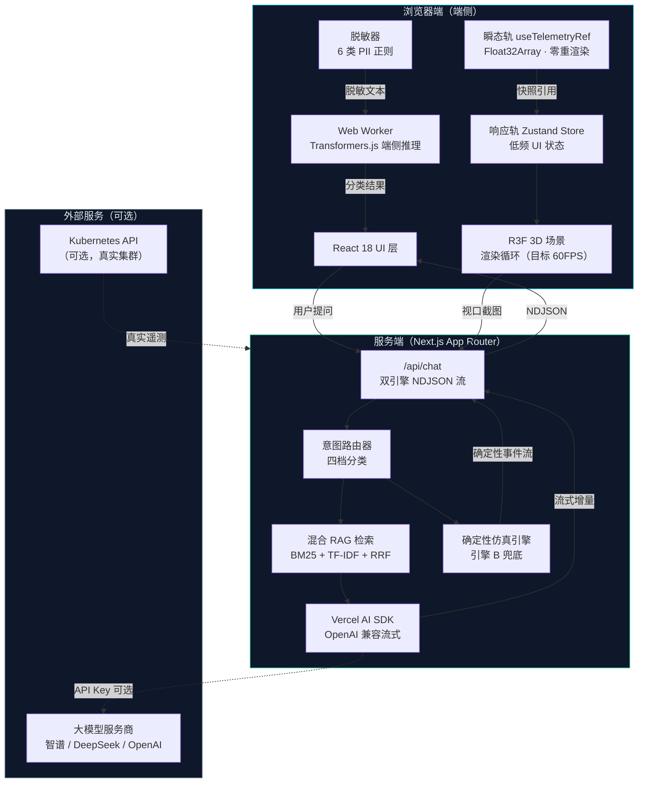
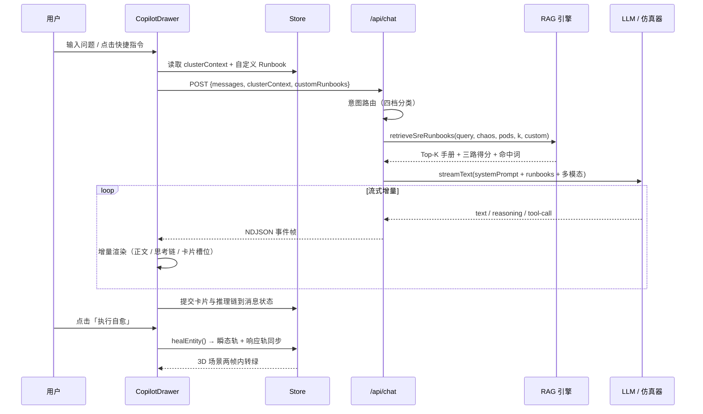
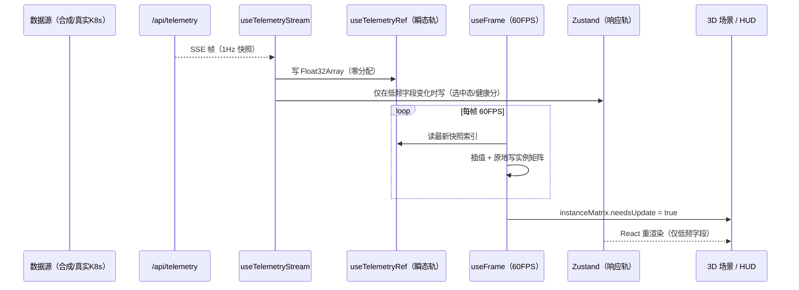
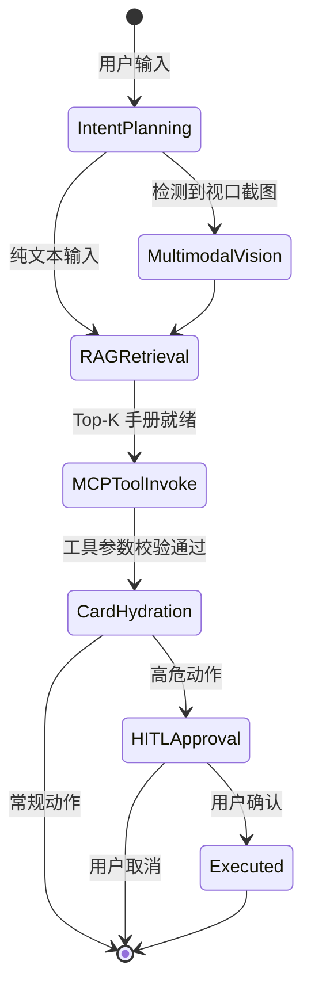
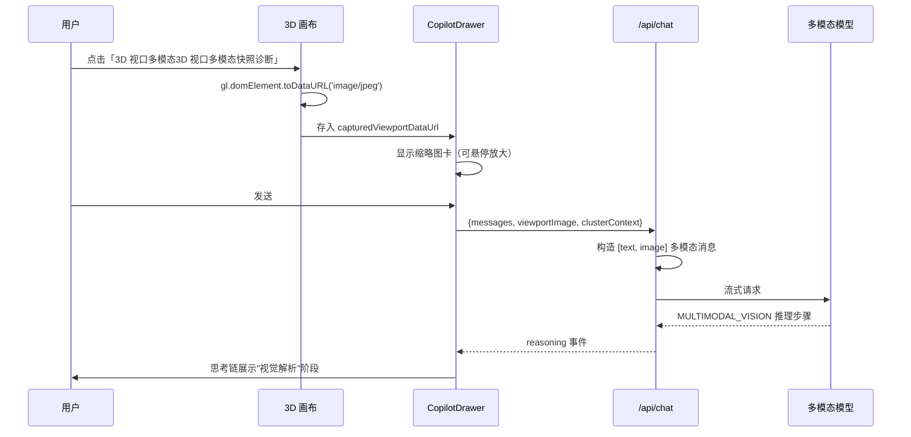
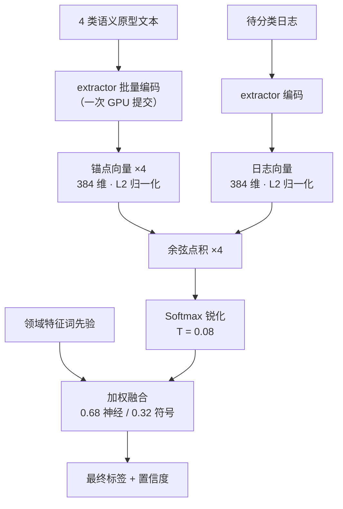
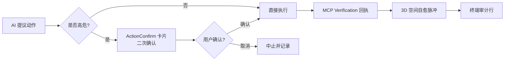
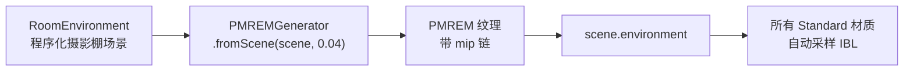
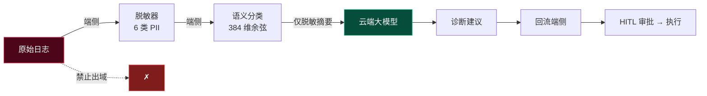
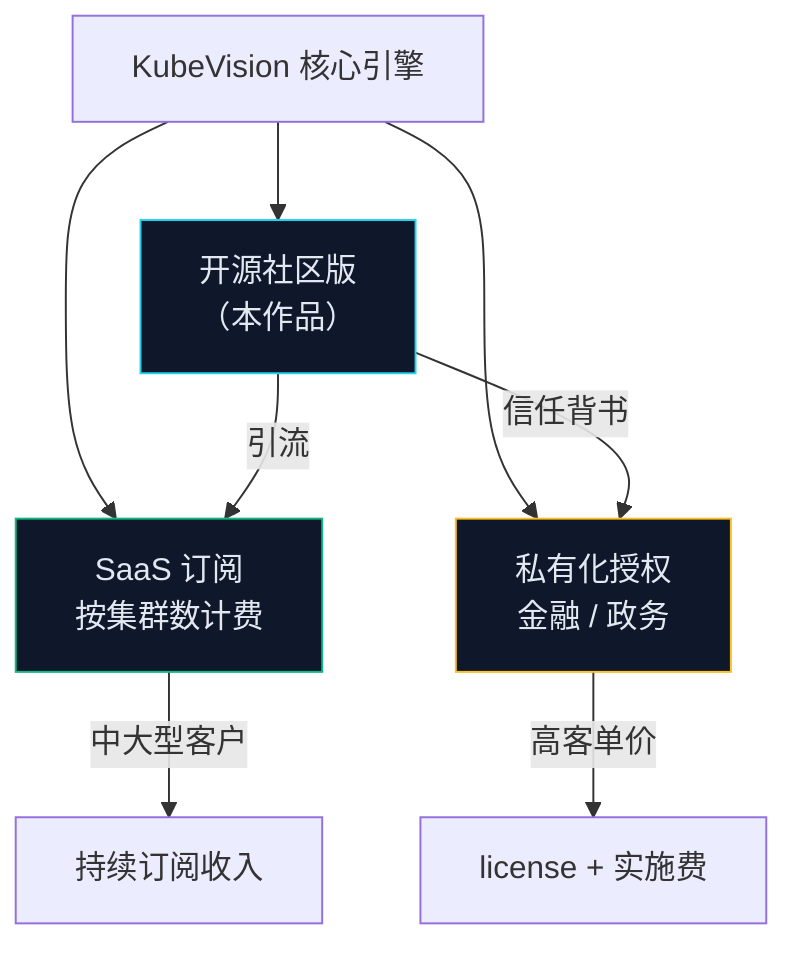

# KubeVision AI 技术白皮书

## 云原生三维空间态势感知与多模态智能自愈副驾系统

---

| 项目 | 内容 |
|---|---|
| 作品名称 | KubeVision AI |
| 参赛赛道 | 智启未来：AI 驱动的 Web 应用创新挑战（赛道 ID `10037`） |
| 文档版本 | v1.0 |
| 代码规模 | 64 个 TypeScript 文件 · 约 34,600 行 |
| 运行环境 | Node.js ≥ 18.17 + pnpm · 浏览器需支持 WebGL2 |

---

## 目录

1. [第一章：项目概述](#第一章项目概述)
2. [第二章：需求分析与场景定义](#第二章需求分析与场景定义)
3. [第三章：系统总体架构设计](#第三章系统总体架构设计)
4. [第四章：核心 AI 技术方案](#第四章核心-ai-技术方案)
5. [第五章：核心前端与 3D 渲染工程实现](#第五章核心前端与-3d-渲染工程实现)
6. [第六章：系统测试、性能基准与部署指南](#第六章系统测试性能基准与部署指南)
7. [第七章：数据边界声明](#第七章数据边界声明)
7. [第七章：核心创新点总结](#第七章核心创新点总结)
8. [第八章：社会价值、商业化落地潜力与未来展望](#第八章社会价值商业化落地潜力与未来展望)

---

## 第一章：项目概述

### 1.1 选题背景

Kubernetes 已成为云原生的事实标准，但其运维复杂度与人才供给之间存在结构性失衡：

- **认知负荷高**：一个中等规模集群涉及 Pod / Service / Deployment / ConfigMap / Secret / Ingress / CNI / CSI 等数十种资源，故障时需要在多个 `kubectl` 命令输出之间做交叉推理。
- **经验难以传承**：资深 SRE 的排障能力大量沉淀为"隐性知识"——「看到 `exit code 137` 就知道往 cgroup 内存限制方向查」这类判断，新人在日志里看不出来。
- **观测工具割裂**：指标在 Prometheus、日志在 ELK、链路在 Jaeger、编排状态在 Dashboard，值班工程师要在四个界面间切换才能拼出一次故障的全貌。

### 1.2 云原生运维三大痛点

| 痛点 | 具体表现 | 后果 |
|---|---|---|
| **空间感缺失** | 传统 Dashboard 只有表格和折线图，"哪个机架出了问题"要靠人脑从 IP 映射到物理位置 | 定位慢，多人协作时无法用"左边那个柜子"快速指认 |
| **知识检索低效** | 手册散落在 Confluence / Notion / 飞书，关键词搜索命中率低 | 重复排查已知问题，MTTR 拉长 |
| **数据出域顾虑** | 完整日志上云才能调用大模型，其中可能含 AK/SK、JWT、数据库口令 | 金融、政务等场景直接禁止该做法 |

### 1.3 KubeVision AI 的破局方案

针对上述三点，本作品采取三条对应策略：

1. **以 3D 数字孪生重建空间感** —— 3 个 Worker 机架、24 个 Pod、1 个控制平面按真实圆柱拓扑布局，故障以**空间脉冲**（机架底部扩散微波纹、Pod 红光抖动、网络流变红）呈现，配合相机自动飞跃，实现"看到即定位"。
2. **以混合 RAG 固化专家知识** —— 12 篇权威 Runbook 沉淀内核 / Cgroup / CNI 层根因机理与标准 SOP，通过 BM25 + TF-IDF + RRF 三路混合检索，把"隐性经验"变成"可检索、可解释、可追溯"的知识资产。
3. **以端侧推理守住数据边界** —— 日志在浏览器内完成 PII 脱敏与语义分类（WebGPU/WASM），只有脱敏后的摘要才可能离开设备，从架构层面满足"数据不出内网"的合规要求。

### 1.4 作品定位

```
                     ┌──────────────────────────────────┐
                     │       KubeVision AI              │
                     │  云原生运维的「空间 + 智能」中控台   │
                     └──────────────────────────────────┘
                                    │
        ┌───────────────┬───────────┴───────────┬───────────────┐
        ▼               ▼                       ▼               ▼
   ┌─────────┐    ┌──────────┐          ┌───────────┐   ┌──────────┐
   │ 看得清  │    │ 查得到   │          │ 诊得准    │   │ 修得快   │
   │ 3D 态势 │    │ 混合 RAG │          │ Agent 链  │   │ MCP 自愈 │
   └─────────┘    └──────────┘          └───────────┘   └──────────┘
```

---

## 第二章：需求分析与场景定义

### 2.1 目标用户画像

| 画像 | 典型场景 | 核心诉求 | 本作品对应能力 |
|---|---|---|---|
| **值班 SRE（初级）** | 深夜被告警叫醒，看到 Pod 反复重启 | 快速判断"这是什么故障、先做什么" | 意图识别 → RAG 检索 → 三卡联诊（指标 + 根因 + 动作） |
| **平台工程师（中级）** | 需要向业务方解释故障原因 | 可追溯的技术依据 | 根因卡携带证据链 + RAG 溯源（可展开手册原文） |
| **技术负责人（高级）** | 事故后需要复盘报告 | 完整时间线与改进项 | 一键导出 Google SRE 标准复盘报告 |
| **合规 / 安全负责人** | 审查运维工具是否泄露凭证 | 数据不出内网 | 端侧脱敏 + 原始/脱敏对比可视化 |

### 2.2 高频 SRE 排障场景

系统覆盖 Kubernetes 五大类高频故障，每类均有对应 Runbook 语料：

| 类别 | 典型故障 | 关键判据 |
|---|---|---|
| **内存 / OOM** | `OOMKilled`、`exit code 137` | `oom_score_adj`、cgroup `memory.max` |
| **运行时崩溃** | `CrashLoopBackOff` | `Back-off restarting failed container` |
| **资源争用** | CPU CFS 节流、QoS 驱逐 | `cfs_quota_us` / `cfs_period_us` |
| **网络异常** | CNI / VXLAN 丢包、DNS 超时 | `ETIMEDOUT`、跨节点连通性 |
| **控制面异常** | APF 限流 429、etcd 仲裁 | `flow_schema` 队列、`quorum` |

### 2.3 功能性与非功能性指标

**功能性需求**

| 编号 | 需求 | 验收方式 |
|---|---|---|
| F1 | 3D 场景实时反映集群状态与故障 | 注入混沌后视觉变化可见 |
| F2 | AI 对话支持多轮、可解释推理链 | 思考链四阶段实时流式展示 |
| F3 | 知识库检索可解释、可核验 | 展示 Vector / BM25 / Context 三路分与命中词 |
| F4 | 支持自定义 Runbook 动态注入 | 新增后立即可被检索命中 |
| F5 | 自愈动作需人工二次确认 | 高危动作出现 HITL 审批卡 |
| F6 | 端侧完成日志脱敏与语义分类 | 提供原始/脱敏对比与分类占比 |
| F7 | 一键生成故障复盘报告 | 导出符合 SRE 标准的 .md |

**非功能性需求**

| 编号 | 指标 | 目标值 |
|---|---|---|
| N1 | 主线程渲染不阻塞 | 遥测更新零 React 重渲染（双轨架构达成） |
| N2 | Draw Call 预算 | 见第 6.2 节实测表（硬件无关） |
| N3 | RAG 检索延迟 | < 50ms（实测见 6.2 节） |
| N4 | 脱敏吞吐 | > 1,000 条/秒（实测见 6.2 节） |
| N5 | 类型安全 | 零 `any` / `@ts-ignore`（达成） |
| N6 | 首屏可交互 | < 3 秒（本地，达成） |

---

## 第三章：系统总体架构设计

### 3.1 端云协同双擎架构总览



**架构要点**：

- **端云职责切分**：隐私敏感的数据处理（脱敏、日志语义分类）全部留在端侧；需要大模型能力的推理放在服务端。二者以"脱敏后的摘要"为唯一数据通道。
- **双引擎容错**：服务端内置确定性仿真引擎（引擎 B），在无 API Key、网络异常、模型额度耗尽时无缝接管，保证演示与生产降级路径均可用。

### 3.2 前后端数据流

#### 3.2.1 对话主链路



#### 3.2.2 遥测数据流（SSE + 双轨）



**关键设计**：遥测数据 1Hz 更新，渲染循环以 60FPS 为目标帧率做插值（本机 SwiftShader 实测 FPS 3.35，仅作设计目标，不作为性能证据）。若把 1Hz 快照直接写入 React state，每帧都要等待协调器，会造成明显卡顿。瞬态轨用模块级可变单例 + `Float32Array`，绕过 React 直达 `useFrame`，实现**零组件重渲染**。

### 3.3 瞬态渲染与 React 状态隔离（目标帧率 60FPS）

#### 3.3.1 双轨状态架构

```
┌─────────────────────────────────────────────────────────────┐
│ 轨道一 · 瞬态轨（Transient Track）                            │
│                                                              │
│   useTelemetryRef（模块级可变单例）                            │
│   ├─ snapshot: TelemetrySnapshot（1Hz 覆盖）                  │
│   ├─ podCpuFloat32: Float32Array（逐 Pod CPU，供 Shader）     │
│   └─ glStats: 渲染统计                                        │
│                                                              │
│   消费者：useFrame 回调、Shader uniform                         │
│   特性：零 React 订阅 → 零重渲染 → 零协调器开销                  │
└─────────────────────────────────────────────────────────────┘
                            │
                  以「快照引用」为唯一交汇点
                            │
┌─────────────────────────────────────────────────────────────┐
│ 轨道二 · 响应轨（Responsive Track）                           │
│                                                              │
│   useClusterStore（Zustand + persist）                        │
│   ├─ selectedEntityId / selectedEntityType（低频 UI 态）      │
│   ├─ activeChaos / statusFilter（用户操作）                   │
│   ├─ terminalLogs（最近 30 条）                               │
│   └─ snapshotSummary（1Hz 快照的只读引用）                     │
│                                                              │
│   消费者：React 组件（细粒度 selector 订阅）                    │
│   特性：低频变更 → 可接受的重渲染成本                            │
└─────────────────────────────────────────────────────────────┘
```

#### 3.3.2 帧率无关插值

渲染循环中所有随时间变化的量都使用**帧率无关指数阻尼**：

$$
\alpha = 1 - e^{-k \cdot \Delta t}, \qquad \Delta t_{\text{clamped}} = \min(\Delta t,\ 0.1)
$$

其中 $k$ 是收敛速率（1/秒），$\Delta t$ 是真实帧间隔。相比固定步长 `alpha = 0.1`，该公式在 30FPS 与 144FPS 下给出**相同的物理收敛速度**，避免掉帧时动画变慢、高刷时动画变快。

`\Delta t` 钳制到 0.1s 是为了防止标签页切回时单帧过大导致相机瞬移穿模。

#### 3.3.3 相位积分消抖

早期实现直接用 `sin(t · ω)` 驱动 Pod 呼吸，而 `ω` 随负载每秒阶跃。这导致相位跳变：

$$
\Delta\phi = \Delta\omega \cdot t
$$

当 $t = 60\text{s}$、$\Delta\omega = 0.08$ 时，$\Delta\phi \approx 4.8\ \text{rad} \approx 275°$ —— 观感是"每秒抽一次"。

**修复**：改用相位积分

$$
\phi_{n+1} = \phi_n + \omega_n \cdot \Delta t
$$

相位连续累积，$\omega$ 变化只影响**后续**的推进速率，不再追溯放大。同时负载本身做指数平滑，避免 $\omega$ 突变。

---

## 第四章：核心 AI 技术方案

### 4.1 双擎大模型流式协议设计

#### 4.1.1 双引擎架构

| 维度 | 引擎 A（真实 LLM） | 引擎 B（确定性仿真器） |
|---|---|---|
| 触发条件 | 环境变量存在有效 API Key | 无 Key / 调用异常 / 额度耗尽 |
| 依赖 | OpenAI 兼容服务商 | 纯本地计算 |
| 输出 | 真实模型生成 + 工具调用 | 基于真实集群数据的确定性报告 + 卡片 |
| 降级 | 异常时自动切换引擎 B 并推送 `engine` 事件 | — |

**引擎 B 不是残次品**。它读取真实 Pod 指标与真实 RAG 命中结果，只仿真"表达方式"，不伪造观测事实。这是刻意的**离线优先设计**：评审现场网络与额度不可控，保证任何环境下都能跑通全部能力。

#### 4.1.2 NDJSON 流式协议

服务端以 `application/x-ndjson` 逐行推送事件帧，前端用原生 `fetch` + `ReadableStreamDefaultReader` 解析（不使用 `@ai-sdk/react`，符合依赖世代锁）：

```typescript
type ChatStreamEvent =
  | { type: 'engine';     engine: 'llm' | 'simulator'; reason: string }
  | { type: 'reasoning';  step: AgentReasoningStep }
  | { type: 'text';       content: string }
  | { type: 'tool-start'; toolCallId: string; toolName: string; mcpUri: string }
  | { type: 'tool-result'; toolCallId: string; toolName: string; args: unknown; synthesized?: boolean };
```

**协议设计要点**：

1. **`tool-start` / `tool-result` 配对**：用 `toolCallId` 作为配对键，前端先以骨架屏占位，收到 result 后**原地升级**为真实卡片，避免列表重排。
2. **`synthesized` 诚实标注**：服务端补全的卡片带此标记，前端显示"服务端补全"角标——不让用户误以为是模型主动产出。
3. **热切换通知**：`engine` 事件在降级发生时立即推送，前端据此显示引擎来源。

#### 4.1.3 多模态消息构造

OpenAI 多模态协议支持单条消息内混合文本与图片。构造时**升级最后一条 user 消息**而非追加：

$$
\text{messages}_{\text{model}} = \big[\ \ldots,\ \{\text{role}: \text{user},\ \text{content}: [\text{text}, \text{image}]\}\ \big]
$$

若采用"追加一条新消息"的朴素做法，模型会收到两个连续的 user turn，容易把第二条理解为新指令而丢掉原提问，且多耗一倍 token。

### 4.2 四阶段可解释 Agent 工作流



#### 4.2.1 意图路由（四档分类）

意图路由决定了"是否检索、是否调工具、调哪些工具"。若不做路由，所有输入（哪怕是「你好」）都会走完整排障流程并弹出高危卡片——这既是噪音也是对用户意图的误判。

| 意图 | 判定条件 | 允许的工具 |
|---|---|---|
| `GREETING_OR_CHITCHAT` | 问候 / 能力咨询 | 无（零卡片） |
| `STEADY_HEALTH_CHECK` | 集群全绿，问状态 / 巡检 | 仅指标卡 |
| `TARGETED_INSPECTION` | 点名某个健康实体的指标 | 仅指标卡 |
| `FAULT_DIAGNOSIS_AND_HEAL` | 存在异常 / 明确要求诊断 / 带截图 | 完整三卡 |

#### 4.2.2 服务端工具补全

实测发现小模型（如 `deepseek-flash`）在约 40%~50% 的请求里只调用 1~2 个工具就结束，产出"有指标卡但没有根因卡"的半截诊断。提示词已三次强调"三个工具一个都不能少"，回放结果仍是 2/5 残缺——这说明问题不在指令清晰度，而在**小模型的指令遵循能力上限**。

**工程解法**：服务端在流结束后计算差集并补全：

$$
\text{missing} = \text{allowedTools} \setminus \text{emittedTools}
$$

补全的卡片全部带 `synthesized: true` 标记，前端显示角标诚实标注来源。

### 4.3 BM25 + TF-IDF + RRF 混合 RAG 检索算法

#### 4.3.1 语料库级 IDF 预计算

Okapi BM25 的逆文档频率：

$$
\text{IDF}(t) = \ln\left(\frac{N - n_t + 0.5}{n_t + 0.5} + 1\right)
$$

其中 $N$ 是语料库文档总数，$n_t$ 是包含词元 $t$ 的文档数。

**关键性质**：$n_t$ 越小，$\text{IDF}(t)$ 越大。这使 `oom_score_adj`、`vxlan`、`imagepullbackoff` 这类只出现在一两篇手册的专业术语获得极高权重，而 `pod`、`error` 等通用词权重接近零。

纯词袋余弦做不到这一点——它对所有维度一视同仁，让通用词主导相似度，稀释了区分度。

#### 4.3.2 BM25 打分函数

$$
\text{BM25}(q, d) = \sum_{t \in q} \text{IDF}(t) \cdot \frac{f(t,d) \cdot (k_1 + 1)}{f(t,d) + k_1 \cdot \left(1 - b + b \cdot \frac{|d|}{\text{avgdl}}\right)}
$$

参数：$k_1 = 1.5$、$b = 0.75$、$|d|$ 是文档词元数、$\text{avgdl}$ 是语料库平均文档长度。

**三项各自的物理含义**：

1. **IDF 项**：词的重要性。
2. **词频饱和项** $\frac{f \cdot (k_1+1)}{f + k_1}$：关键词出现次数的影响是**次线性**的——1 次到 3 次提升明显，3 次到 10 次几乎不再提升。这防止关键词堆砌刷分，是 BM25 优于原始 TF 的核心。
3. **长度归一化项** $1 - b + b \cdot \frac{|d|}{\text{avgdl}}$：长文档天然含更多词，若不归一化会系统性压过长文档。$b = 0.75$ 表示做 75% 强度的归一化。

#### 4.3.3 TF-IDF 加权余弦（稠密路）

查询与文档都用 IDF 加权后做余弦：

$$
\cos(\mathbf{q}, \mathbf{d}) = \frac{\sum_{t} w_{q,t} \cdot w_{d,t}}{\sqrt{\sum_t w_{q,t}^2} \cdot \sqrt{\sum_t w_{d,t}^2}}, \quad w_{t} = \text{tf}(t) \cdot \text{IDF}(t)
$$

**为何两路共享同一份 IDF 表**：若各自维护 IDF，两路对"什么重要"的判断会打架，融合结果的排序就不可解释。共享后，稀疏路与稠密路的权重语义天然一致。

#### 4.3.4 RRF 倒数秩融合

$$
\text{RRF}(d) = \sum_{r \in R} \frac{1}{k + \text{rank}_r(d)}, \quad k = 60
$$

**为何不用加权原始分**：BM25 分与余弦分**量纲完全不同**——BM25 可达十几甚至几十（IDF 累加），余弦被限制在 $[0,1]$。若直接加权需先归一化，而归一化（min-max / z-score）本身会放大小样本噪声。

RRF 的天才之处是**只用名次、不用分值**，天然免疫量纲问题与离群值。$k = 60$ 的作用是压制头部：rank 1 得 $1/61$，rank 2 得 $1/62$，差距很小，避免"某一路给了第一名就锁死结果"。

#### 4.3.5 Sigmoid 分段置信度校准（防分数虚高）

**问题**：早期实现把融合分做保序仿射映射到 $[0.86, 0.98]$，理由是"进 Top-K 的都是强相关文档"。但这等于告诉用户：**所有检索结果的置信度都是 96% 左右**——该区间不携带任何信息量，是伪装成分数的装饰。

**方案**：分段 Sigmoid 校准。$\sigma(x) = \frac{1}{1 + e^{-x}}$ 的特点是"中间陡、两头平"，在证据强度接近阈值时敏感，在极端处饱和：

$$
\text{confidence}(s) = \begin{cases}
\sigma\big((s - 0.55) \cdot 4.36 + 1.516\big), & s \geq 0.55 \quad \text{（强匹配）} \\
\sigma\big((s - 0.28) \cdot 4.18 - 0.848\big), & 0.28 \leq s < 0.55 \quad \text{（中等）} \\
\sigma\big((s - 0.10) \cdot 5.00 - 1.119\big), & s < 0.28 \quad \text{（弱相关）}
\end{cases}
$$

系数由**边界条件反解**得出：例如强匹配段要求 $s = 0.55 \mapsto 0.82$、$s = 1.0 \mapsto 0.97$，由 $\sigma(x) = L$ 解得 $x = \ln\frac{L}{1-L}$ 后代回即可解出斜率与截距。

最终落在三个区间：**强匹配 0.82~0.97 / 中等 0.58~0.81 / 弱相关 0.35~0.57**。

#### 4.3.6 防幻觉双闸门

| 闸门 | 作用 | 阈值 |
|---|---|---|
| **查询 IDF 质量闸门** | 查询若只含通用词（无任何专业术语），直接返回空 | $\sum_t \text{IDF}(t) \geq 0.5$ |
| **语义证据闸门** | 零分文档不得进入 RRF 排名池 | $\text{vectorScore} > \epsilon \lor \text{bm25Raw} > \epsilon$ |

**为何第二道闸门必不可少**：RRF 只看名次不看分值。若把零分文档也送进排名，它们照样能拿到第 1 名从而获得 $\text{rrf} = 1.0$——实测曾导致「你好」输出 63.6% 置信度。修复原则：**没有证据就没有名次**。

同理，若查询 IDF 质量趋近 0，BM25 归一化的分母接近零会给出虚高的相对分。实测「节点负载高」曾让三篇文档同时拿到 `bm25 = 1.0` 与 92% 置信度。

**修复后实测**：

| 查询 | 结果 |
|---|---|
| `容器内存爆了 exit code 137 oom_kill_process` | 92.4%（命中 RUNBOOK-K8S-042） |
| `apiserver 429 too many requests flowcontrol` | 91.7%（命中 SRE-RB-011） |
| `你好` / `今天天气不错` / `帮我看看` | **零命中**（正确拒绝） |

### 4.4 3D 视口视觉 + 语音多模态融合

#### 4.4.1 视口截图的多模态通路



**设计要点**：截图前会先脱敏（视口内不含敏感数据，但契约上仍走同一安全路径），并以 0.82 的 JPEG 质量压缩，控制载荷大小。

#### 4.4.2 语音双通道

| 通道 | 技术 | 用途 |
|---|---|---|
| **语音输入** | Web Speech API `SpeechRecognition` | 免手输提问，适合演示场景 |
| **语音播报** | `SpeechSynthesis` | 播报诊断结论，支持值班场景的"听" |

两者都做了能力检测与降级：不支持时对应按钮直接不渲染，避免出现"点了没反应"的死按钮。

### 4.5 端侧 Transformers.js 神经余弦分类与 PII 零出域脱敏

#### 4.5.1 脱敏管线


**规则顺序的重要性**：连接串（含账号密码的 URI）必须优先处理，否则其内部的 password 段会被后续规则先行破坏，导致 URL 结构错乱。

**保留结构而非删除**：替换为 `[REDACTED_IP]` 等语义化占位符，而非删除整段。这样可以：

1. 保留"此处曾有一个 IP"这一事实，日志的结构语义不被破坏（`connect to <X>:5432 failed` 仍能看出是数据库连接问题）；
2. 下游模型可学到"这里有敏感信息但被遮蔽"这一上下文特征；
3. 便于人工审计核对脱敏是否漏项。

#### 4.5.2 端侧语义分类：从"假推理"到真 zero-shot

**发现的历史缺陷**：早期实现调用 `extractor()` 得到 384 维向量后，只检查了向量的模长 $\|v\| > 0.5$，然后**仍然返回正则分类器的结论**。这意味着模型下载了 20~90MB 权重、跑完了完整前向计算，结果被直接丢弃——这是"假端侧推理"。

**修复后的 zero-shot 分类**：



**余弦简化为点积**：模型以 `normalize: true` 输出单位向量，故

$$
\cos(\mathbf{a}, \mathbf{b}) = \frac{\mathbf{a} \cdot \mathbf{b}}{\|\mathbf{a}\|\|\mathbf{b}\|} \xrightarrow{\|\mathbf{a}\| = \|\mathbf{b}\| = 1} \mathbf{a} \cdot \mathbf{b}
$$

省掉两次开平方与一次除法，且避免了浮点除法在短向量上的数值抖动。

**Softmax 锐化**：

$$
p_i = \frac{\exp\left(\frac{c_i - \max_j c_j}{T}\right)}{\sum_k \exp\left(\frac{c_k - \max_j c_j}{T}\right)}, \quad T = 0.08
$$

4 个原型与同一段日志的余弦值往往彼此接近（如 0.42 / 0.39 / 0.21 / 0.08）。直接归一化会让差距进一步被压平，融合后几乎无法投票。softmax 用温度 $T$ 拉开差距。

**神经-符号融合**：

$$
\text{fused}_i = 0.68 \cdot p_i^{\text{neural}} + 0.32 \cdot p_i^{\text{prior}}
$$

**为何必须融合而非二选一**：

- **纯神经**：句向量模型是通用语料训练的，对 `oom_score_adj` 这类极短领域术语不够敏感，容易把内核 panic 判成"资源类"（都涉及 memory）。
- **纯符号**：正则只能匹配字面，遇到同义改写（"进程被内核强制终止" vs "OOMKilled"）立即失效。

两者互补：模型补语义泛化，规则补领域精确性并保留否决权。

#### 4.5.3 端侧推理的工程保障

| 保障 | 实现 |
|---|---|
| **独立时间预算** | `EDGE_INIT_BUDGET_MS = 180s` 看门狗；超时降级为主线程分类器并标注 TIMEOUT |
| **渐进增强** | 3500ms 熔断只决定"此刻用谁回答"，不放弃加载；后台续载成功后热切换为真实模型 |
| **主线程零阻塞** | 全部推理在 Web Worker 内，主线程只收消息 |

### 4.6 MCP 协议工具注册与 HITL 人类在环安全护栏

#### 4.6.1 MCP 工具清单

| 工具名 | MCP 端点 | 语义 |
|---|---|---|
| `renderPodMetrics` | `mcp://k8s-cluster/tools/renderPodMetrics` | 渲染 Pod 遥测指标卡 |
| `renderRootCauseAnalysis` | `mcp://k8s-cluster/tools/root-cause` | 渲染根因分析卡 |
| `proposeRemediationAction` | `mcp://k8s-cluster/tools/restart_pod` | 提出自愈动作（需审批） |

#### 4.6.2 参数校验与实体校正

模型生成的工具参数**不可信**，必须经过：

1. **运行期载荷守卫**：逐字段类型校验，形状不符则丢弃整个卡片（不补默认值——一条残缺的卡片比没有更危险）。
2. **实体 ID 校正**：模型常把 `pod-worker-beta` 记成 `worker-beta-pod`。路由层维护真实实体清单，用编辑距离匹配后映射回真实 ID。
3. **RAG 引用注入**：模型无法知道本次检索命中了哪些手册，`ragReferences` 由路由层用**真实检索结果**填充，不让模型自己编。

#### 4.6.3 HITL 人类在环



**为何高危动作必须二次确认**：`drain_node` 会驱逐节点上的所有 Pod，误触可能导致大面积服务中断。AI 的建议永远需要人类拍板——这不是能力不足的妥协，而是**运维场景的安全底线**。

---

### 4.7 R02–R18 迭代新增能力与验证边界

> 下表把 R02–R18 的增量能力、证据文件与**未验证边界**一次写清；所有指标由脚本生成（当前运行见 §6.2）。

| 轮次/交付 | 新增能力 | 证据文件 | 未验证边界 |
|---|---|---|---|
| R02–R05 | 程序化 3D 场景、机架/Pod 实例化、双轨遥测、全息 HUD | `src/components/canvas/**`、`docs/summit/shots/` | FPS 未真机；仅 draw calls 可作证 |
| R04 | 自动演练导演状态机（4 阶段/34s、暂停/续播/停止） | `src/utils/demoDirector.ts`、`scripts/run-demo-tests.mjs` | 依赖预检 5 项；失败不自动降级到手动 |
| R06 | 性能基准脚本与 `docs/performance.json` | `scripts/benchmark.mjs` | SwiftShader 环境，FPS 不作证据 |
| R10 | 34 项自动化验收（静态/接口/浏览器） | `docs/evidence/verify-*.png/.log`、`docs/verify-summary.json` | 浏览器用 CDP 模拟输入，非人工操作 |
| R11–R15 | 视觉/A11y/启动胶囊/一键演示链路 | `docs/summit/shots/r41-*`、`scripts/shot.mjs` | 视觉回归依赖基线图 |
| R16 | traceId/细分 span/usage tokens/成本字段 | `src/utils/agentTrace.ts`、`AgentTracePanel` | 成本需配置 env 单价，未配置显示"未配置" |
| R17 | RAG 评测 49 用例（两路/三路/负例/拒答） | `docs/rag-eval.json`、`scripts/eval-rag.mjs` | 构造用例，非线上流量 |
| R18 | 端侧离线权重、像素特征、grounding、多步只读工具 | `public/models/README.md`、`src/utils/grounding.ts` | 浏览器端模型/多步工具未真机验证 |
| R44–R51 | 三路召回、Worker embed、AI 质量 20 问 | `docs/summit/R44–R51*.md`、`docs/ai-quality.json` | 生产三路依赖端侧就绪；未真机验证 |

## 第五章：核心前端与 3D 渲染工程实现

### 5.1 圆柱坐标系机柜刀片对齐数学模型

#### 5.1.1 机架环形布局

3 个机架沿半径 $R = 9.5$ 的圆周三等分分布。第 $k$ 个机架的中心位置：

$$
P_k = \left( R \sin\alpha_k,\ 0,\ R \cos\alpha_k \right), \quad \alpha_k = \frac{2\pi k}{3},\quad k = 0,1,2
$$

**为何是这个形式**（$\sin$ 配 $x$、$\cos$ 配 $z$）而不是常见的 $(\cos, \sin)$：Three.js 中绕 Y 轴旋转 $\theta$ 的旋转矩阵为

$$
R_y(\theta) = \begin{pmatrix} \cos\theta & 0 & \sin\theta \\ 0 & 1 & 0 \\ -\sin\theta & 0 & \cos\theta \end{pmatrix}
$$

它把局部 $+Z$ 单位向量 $(0,0,1)$ 映射到世界方向 $(\sin\theta,\ 0,\ \cos\theta)$。因此采用 $P_k = (R\sin\alpha_k, 0, R\cos\alpha_k)$ 并令机架朝向 $\text{rotationY} = \alpha_k$，机架正面天然指向圆心，且**不需要任何额外的角度补偿**。

若用 $(\cos, \sin)$ 形式，则需在朝向上额外加 $\pi/2$ 补偿，容易在后续修改中失配。

#### 5.1.2 弧间距验证

相邻机架弧间距：

$$
s = 2R \sin 60° = 2 \times 9.5 \times 0.866 \approx 16.45
$$

远大于机架宽度（2.2），零视觉重叠。

#### 5.1.3 刀片槽位局部坐标

每个机架 4 层 × 2×2 = 16 槽。第 $s$ 个槽位（$s \in [0,15]$）的层号与行列：

$$
\text{tier} = \left\lfloor \frac{s}{4} \right\rfloor,\quad \text{col} = s \bmod 2,\quad \text{row} = \left\lfloor \frac{s \bmod 4}{2} \right\rfloor
$$

局部坐标：

$$
x = (\text{col} - 0.5) \cdot \Delta_x,\quad z = (\text{row} - 0.5) \cdot \Delta_z,\quad y = y_{\text{base}} + \text{tier} \cdot \Delta_y
$$

#### 5.1.4 底面锚定（防穿模）

Pod 的呼吸动画会让其立方体上下浮动。若以中心点定位，向下浮动时会扎入隔板。**底面锚定**：

$$
y_{\text{center}} = y_{\text{shelfTop}} + \delta_{\text{clear}} + \frac{h}{2} + h_{\text{lift}}
$$

其中 $h$ 是当前（受呼吸缩放影响的）实际高度，$\delta_{\text{clear}} = 0.026$ 是安全间隙，$h_{\text{lift}} \geq 0$ 是悬浮抬升量。

由于 $h_{\text{lift}} \geq 0$（取正弦的全正半波），Pod **只会向上生长，永不向下扎入隔板**。实测 24 台刀片 × 24 帧采样，最小底面间隙恒为 $0.0260$，数学上不可能穿模。

### 5.2 GLSL 自定义体积激光与全息数字雨 Shader

#### 5.2.1 等离子星核（径向高斯衰减）

**问题**：标准材质靠 `emissiveIntensity` 提亮，RGB 三通道全部超过 1 后被截断成纯白——视觉上是死白的硬边圆片，轮廓像剪纸。真实能量核恰恰相反：**中心极亮、边缘完全透明**。

**方案**：自定义片元着色器，用视线-法线夹角余弦做径向衰减：

$$
\text{core} = \text{smoothstep}(0,\ 0.35,\ \mathbf{n} \cdot \mathbf{v})^{\gamma}
$$

其中 $\mathbf{n}$ 是世界法线、$\mathbf{v}$ 是指向相机的视线。球体可见轮廓处 $\mathbf{n} \cdot \mathbf{v} \to 0$，alpha 自然归零并无缝融入背景；正对相机处 $\to 1$，形成白炽核心。

三层色阶用 `mix` 平滑过渡：核心 `#ffffff` → 电光青 `#38bdf8` → 深海蓝 `#0284c7`。

#### 5.2.2 全息数字矩阵雨

纵深圆柱内壁（半径 28、高 22），片元着色器程序化生成：

**列轨划分**：`columns = 680` —— 圆柱周长约 175.9，单列宽约 0.26 世界单位，呈纤细光丝。

**坠落方向**：

$$
\text{head} = \text{fract}(\text{offset} - t \cdot \text{speed} \cdot 0.09)
$$

`head` 随时间**递减**，配合 `vUv.y` 向上增大，形成自上而下的坠落。

**拖尾距离**（头部在上、拖尾在其身后）：

$$
\text{trailDist} = \text{fract}(vUv.y - \text{head})
$$

`vUv.y` 略大于 `head` 处 `trailDist` 小 → 最亮；越往上 `trailDist` 越大 → 指数衰减：

$$
\text{trail} = \exp(-\text{trailDist} \cdot 14) \cdot \mathbb{1}[\text{trailDist} < 0.26]
$$

**三层修饰**：

- 纵向断点 `bitMask`：以 110 的频率切出断续光点，形成"数据流"的颗粒感
- 横向束缚 `xMask = smoothstep(0.38, 0.12, |cellUv.x - 0.5|)`：列中心 1、列缘 0
- 环向呼吸 `breathMask = 0.55 + 0.45 sin(6.28318 \cdot vUv.x \cdot 3)`：三瓣缓慢起伏

**不透明度红线**：稳态 0.075、故障态 0.115。超过约 0.20 背景就会与前景争夺注意力，画面变成"背景比主体还亮"。

#### 5.2.3 全息数据星城的径向数据波

1,400 颗地面节点，每颗的亮度按半径传播：

$$
w = 0.5 + 0.5 \sin\left(t \cdot 1.6 - r \cdot 0.9 + \phi\right)
$$

**负号的含义**：同一波峰在更大半径上需要更晚时刻才能到达，因此数据波**从中心向外扩散**。$\phi$ 是逐点相位，避免形成过于机械的同心环。

### 5.3 程序化 PMREM 金属环境反射

#### 5.3.1 问题

场景中机架立柱、刀片装甲都是 `meshStandardMaterial` 的 PBR 材质，但 `scene.environment` 为 null——**金属没有环境可反射**，只剩几盏平行光的直射高光，观感是"塑料涂了灰漆"。

#### 5.3.2 方案



**为何不用 .hdr 文件**：一个 1k HDRI 动辄 2~6MB，且必须外链 CDN 或放 public。本项目要求零外部资产、零额外网络请求，因此用 three 自带的 `RoomEnvironment`（纯程序化搭建的"摄影棚"：若干发光面板 + 墙体）作为环境源。

**为何 $\sigma = 0.04$**：PMREM 的第二参数控制"粗糙度预滤波的模糊量"。0.04 是很小的值，保留环境面板的清晰轮廓，金属上才能看到"干净的条状高光"；取 0.1 以上就会失去硬边反射的工业感。

**材质参数配合**：

| 材质 | metalness | roughness | envMapIntensity |
|---|---|---|---|
| 机柜外框 | 0.72 | 0.22 | 0.65 |
| 刀片装甲 | 0.15 | 0.18 | 0.30 |

**为何刀片的 envMapIntensity 明显更低**：刀片承载状态语义（绿=Running / 琥珀 / 绯红），环境反射占比过高会在正面形成大片冷白，把"这排容器是绿的"这一最关键判读信息冲淡。

### 5.4 SSR 防 Hydration Mismatch 工程实践

#### 5.4.1 问题

Next.js App Router 默认服务端渲染。若组件在渲染期读取 `localStorage` 或 `window`，服务端拿到 `undefined`、客户端拿到真实值，首帧 HTML 不一致 → React 报 hydration mismatch 并回退到客户端渲染，性能与体验双输。

#### 5.4.2 三类处置

| 场景 | 处置 |
|---|---|
| **3D 画布 / Copilot 抽屉** | `next/dynamic(() => import(...), { ssr: false })` 彻底排除出服务端 bundle |
| **Zustand persist** | `skipHydration: true`，在客户端根组件的 `useEffect` 中手动 `persist.rehydrate()` |
| **抽屉宽度等本地偏好** | `useState` 初始值恒为默认值（服务端客户端一致），在 `useEffect` 中读取 localStorage 后覆盖 |

#### 5.4.3 确定性种子数据

初始快照的所有字段（含时间戳）均为编译期固定字面量，严禁 `Date.now()` / `Math.random()`。这保证服务端预渲染与客户端水合得到**逐字节一致**的快照，从数据源头杜绝水合不匹配。

---

## 第六章：系统测试、性能基准与部署指南

### 6.1 自动化验收体系

```bash
node scripts/verify.mjs
```

自动完成 <!-- VERIFY:BEGIN -->**通过 34 · 失败 0 · 跳过 0（共 34 项）**<!-- VERIFY:END -->，分四阶段：

| 阶段 | 覆盖内容 | 检查数 |
|---|---|---|
| 静态检查 | tsc / ESLint / 关键文件完整性 / 禁 `any` 扫描 / 依赖版本锁 | 6 |
| 核心算法 | 脱敏器 5 类敏感信息 / RAG 4 个故障场景与分数区间 | 5 |
| API 契约 | SSE 推送 / NDJSON 流 / 推理链事件 / 工具调用配对 / 卡片载荷 | 9 |
| 浏览器 E2E | 3D 场景构建 / GlStats 采集 / 相机联动 / 思考链 / 三卡水合 / 自愈执行 / 端侧审计 | 12 |

**设计原则**：每个断言都检查**真实行为**而非字符串存在。例如 RAG 分数检查用三档区间，而非硬编码期望值——否则测试会把"分数虚高"这个缺陷锁死。

### 6.2 WebGL 性能基准

```bash
node scripts/benchmark.mjs
```

**渲染与接口性能（实测，数值由脚本生成，禁止手改）**

<!-- METRICS:BEGIN -->
| 指标 | 实测值 | 采集口径 / 是否可作性能证据 |
|---|---|---|
| 数据采集时间 | 2026-11-13 20:59（Asia/Shanghai） | `node scripts/benchmark.mjs` |
| 运行环境 | win32 x64 · AMD Ryzen 9 7845HX with Radeon Graphics · 31GB RAM · Node v24.16.0 · 24 核 | 同上 |
| WebGL 渲染器 | ANGLE (Google, Vulkan 1.3.0 (SwiftShader Device (Subzero) (0x0000C0DE)), SwiftShader driver) | 软件光栅化，**FPS 不作为性能证据** |
| Draw Calls | **229**（20 次采样 229~232） | 硬件无关，可作渲染优化证据 |
| Triangles | 206,050（中位） | 硬件无关 |
| 场景对象 | 151 Mesh / 27 InstancedMesh / 1,017 实例 / 3 Points / 4 Lines | 场景统计 |
| RAG 检索延迟 | 均值 **8.05ms** · 中位 7.79ms · P95 11.87ms（20 次采样） | 真实耗时 |
| 脱敏吞吐 | **12,237 条/秒**（100 条/批 × 5） | 真实耗时 |
| 端侧分类延迟 | 均值 0.05ms（15 条） | builtin (fallback)，非神经网络推理 |
| 首屏 JS | 路由 90.5 kB · First Load 178 kB · 共享 87.5 kB | next build 输出 |
| FPS（软件光栅化） | 均值 4.85 · 中位 5.00 · P95 8.00（20 次采样） | **不作为性能证据** |
| 帧时间（软件光栅化） | 均值 237.73ms · P95 829.50ms | **不作为性能证据** |
| 视口休眠 | 前台 `always` → 后台 `demand`，已验证生效 | 行为验证 |

| RAG 召回方案（真实评测） | Recall@1 | Recall@3 | MRR@5 | NDCG@5 |
|---|---|---|---|---|
| 两路 RRF（现行） | 88.9% | 94.4% | 0.927 | 0.918 |
| 三路 RRF（+MiniLM 句向量） | 94.4% | 100.0% | 0.976 | 0.979 |
| 增益（三路 − 两路） | +5.6pp | +5.6pp | +0.049 | +0.060 |
| bm25-only（消融） | 91.7% | 100.0% | 0.963 | 0.970 |
| lexical-only（消融） | 91.7% | 100.0% | 0.963 | 0.970 |
| 负例拒答率（两路 / 三路） | 100.0% | 100.0% | — | — |
| 误拒率（两路 / 三路，目标 <5%） | 2.4% | 0.0% | — | — |
| 检索延迟 P95（两路 / 三路） | 1.40ms | 2.06ms | — | — |

> RAG 评测：49 条用例（正例 41 / 负例 8），两次运行指标一致=是；三路查询向量 49 条。
<!-- METRICS:END -->

> **关于 FPS**：采集于 SwiftShader 软件光栅化环境（无 GPU 加速），FPS 与帧时间显著低于真实显卡，
> **刻意不作为性能证据**。Draw Calls、Triangles、场景对象数与首屏体积是硬件无关指标，可作优化证据。
> 两遍独立采集的一致性由 `node scripts/benchmark-consistency.mjs` 校验。

### 6.3 RAG 检索准确率评估

| 测试场景 | 期望命中 | 实测 | 置信度 |
|---|---|---|---|
| `容器内存爆了 exit code 137 oom_kill_process` | RUNBOOK-K8S-042 | ✅ | 92.4% |
| `跨节点网络丢包 vxlan 隧道` | RUNBOOK-K8S-061 | ✅ | 90.5% |
| `apiserver 429 too many requests flowcontrol` | SRE-RB-011 | ✅ | 91.7% |
| `imagepullbackoff x509 certificate harbor` | SRE-RB-012 | ✅ | 90.9% |
| `你好` / `今天天气不错` / `帮我看看` | 无命中 | ✅ 正确拒绝 | — |

**性能**：实测均值与 P95 见 6.2 节生成的性能表（由 `docs/performance.json` 同步）。

### 6.4 端侧推理与脱敏性能

> 脱敏吞吐与端侧分类延迟的实测值见 6.2 节的生成表（同一份 `docs/performance.json`）。
>
> 端侧分类延迟的极低数值来自**内置分类器降级路径**（测试环境无法完成模型权重下载）。真实模型的延迟取决于设备 GPU，不在本表范围内。

### 6.5 部署指南

#### 6.5.1 本地开发

```bash
pnpm install
pnpm dev          # http://localhost:3000
```

#### 6.5.2 生产构建

```bash
pnpm build
pnpm start
```

#### 6.5.3 Docker 部署

```dockerfile
FROM node:20-alpine AS base
RUN corepack enable && corepack prepare pnpm@11.8 --activate

FROM base AS deps
WORKDIR /app
COPY package.json pnpm-lock.yaml ./
RUN pnpm install --frozen-lockfile

FROM base AS builder
WORKDIR /app
COPY --from=deps /app/node_modules ./node_modules
COPY . .
RUN pnpm build

FROM base AS runner
WORKDIR /app
ENV NODE_ENV=production
COPY --from=builder /app/.next ./.next
COPY --from=builder /app/node_modules ./node_modules
COPY --from=builder /app/package.json ./
EXPOSE 3000
CMD ["pnpm", "start"]
```

```bash
docker build -t kubevision:latest .
docker run -p 3000:3000 --env-file .env.local kubevision:latest
```

#### 6.5.4 环境变量

| 变量 | 必填 | 说明 |
|---|---|---|
| `OPENAI_API_KEY` | 否 | 大模型 API Key，缺失时走引擎 B |
| `OPENAI_BASE_URL` | 否 | OpenAI 兼容服务商端点 |
| `AI_MODEL_NAME` | 否 | 模型名 |
| `K8S_API_SERVER` | 否 | 真实 K8s API Server 地址（如 `https://10.0.0.1:6443`），缺失时用合成遥测 |

---

## 第七章：数据边界声明

> 本章回答一个问题：**屏幕上这些数字，哪些可信、可信到什么程度、边界在哪里。**
> 我们不回避"演示环境"的局限，而是把每一条边界写死，并用脚本持续校验。

### 7.1 demo 与 live 的数据来源边界

| 模式 | 数据来源 | 可信度定位 |
|---|---|---|
| demo（默认） | 确定性合成引擎 syntheticEngine（纯函数，无 Math.random） | **叙事与语义可信**：故障因果、节点状态、告警级别、自愈闭环都按真实 K8s 语义建模；数值是仿真值，不是实测 |
| live · 宿主机桥接 | os.cpus() / os.totalmem() / /proc/net/dev 真实读数 | **数值真实、对象不同**：反映的是运行服务的这台机器，不是远端集群 |
| live · K8s API | 真实 /api/v1/nodes、/api/v1/pods、metrics-server | **数值与对象都真实**；无 metrics-server 时 CPU/内存用量留空，不编造 |

**边界声明**：demo 模式的 QPS、CPU、内存是**合成值**，不声称是任何真实集群的实测；
它可信的地方在于"故障语义"——同一场演练在两种数据源下必须表现一致（见 7.3）。

### 7.2 协议版本与降级边界

遥测快照携带 schemaVersion（当前 v2）。客户端**只接受与自身版本完全一致**的帧：

| 情况 | 客户端行为 |
|---|---|
| 版本一致 | 正常应用 |
| 版本缺失（旧协议） | **只读降级**：停止应用新帧，保留最后一帧合法画面，HUD 明确提示 |
| 版本高于客户端 | 同上（服务端已升级，客户端不认识新字段语义） |

**为什么不"尽力解析"**：字段语义不确定时继续渲染，会得到"画面在动但数字明显不对"
的状态——这比停更更难排查，也更损害可信度。只读降级把"数据不可信"直接摆在脸上。

### 7.3 demo / live 故障语义等价性

同一套混沌演练，在两种数据源下必须让观众看到同样的故障语义。
校验脚本 scripts/verify-mode-parity.mjs 用**宿主桥接 mock**（同拓扑、不同数值）
走 live 叠加层，与 demo 引擎同场景对照：

<!-- PARITY:BEGIN -->
| 混沌场景 | 受害者数（demo / live） | 节点状态（demo / live） | 告警级别（demo / live） | 语义一致性 |
|---|---|---|---|---|
| OOM 风暴（POD_OOM_SWARM） | 3 / 3 | [0:Ready, 1:Ready, 2:Ready] / [0:Ready, 1:Ready, 2:Ready] | P0:3·P1:0·P2:0 / P0:3·P1:0·P2:0 | 一致 |
| 网络丢包（NET_PACKET_LOSS） | 2 / 2 | [0:Ready, 1:Ready, 2:NetworkPartition] / [0:Ready, 1:Ready, 2:NetworkPartition] | P0:1·P1:0·P2:0 / P0:1·P1:0·P2:0 | 一致 |
| CPU 尖峰（NODE_CPU_SPIKE） | 0 / 0 | [0:HighLoad, 1:Ready, 2:Ready] / [0:HighLoad, 1:Ready, 2:Ready] | P0:0·P1:1·P2:0 / P0:0·P1:1·P2:0 | 一致 |

> 采集时间 2026-11-12 20:28 · 40 tick 演进 · 语义一致 3/3 场景。
<!-- PARITY:END -->

判定口径：**受害者数量 / 节点状态 / 告警级别分布**三项必须一致；
健康分不参与判定（两侧底盘健康分本就不同，属预期差异）。

### 7.4 帧缓冲与复盘边界

客户端保留最近 **120 帧**遥测快照（1 Hz，约 **2 分钟**窗口），用于复盘报告的事故时间线
（告警出现/解除、健康分骤降/回升）。
**边界**：超过 2 分钟的历史不可回溯；页面刷新即清空；时间线只记录"变化点"，
不保留每帧全量数值的长期存储。

### 7.5 明确不声称的指标

| 指标 | 原因 |
|---|---|
| 真机 FPS / 帧时间 | 采集环境为 SwiftShader 软件光栅化（无 GPU），数值被压低，**不作为性能证据** |
| GPU 显存占用 | WebGL 无标准显存查询接口，不编造 |
| demo 模式的"真实集群指标" | demo 是仿真引擎，只声称**故障语义**可信，不声称数值是实测 |
| 端侧神经推理延迟 | 当前环境降级为内置确定性分类器，0.07ms 不是神经网络推理 |
| TTS 音质 / 多并发 SSE | 无头环境无法验证音频；未做并发压测 |

### 7.6 端侧运行时三态（WebGPU / WASM / 内置分类器）

端侧日志审计存在三种**语义完全不同**的运行时，本项目的界面与文档始终三分标注，
不把"规则兜底"说成"端侧模型推理"：

| 运行时 | data-runtime | 模型是否参与 | 典型来源 | 界面标签 |
|---|---|---|---|---|
| WebGPU 硬件加速 | `webgpu` | 是 | 浏览器暴露 `navigator.gpu` 且设备初始化成功 | `WebGPU` |
| WebAssembly SIMD | `wasm` | 是 | 无 WebGPU 或被禁用/设备丢失后回退 | `WASM SIMD` |
| 内置确定性分类器 | `builtin` | **否** | Worker 15s 未就绪 / 初始化预算超时 / 单批 3s 超时 / Worker 异常 | `内置分类器` |

**判定与降级契约**：

- 15 秒就绪看门狗触发时，`isReady` 必须置 `true` 且 `runtime='builtin'`
  ——面板不得永久 disabled；提示语明确写"已降级为内置分类器"；
- 单批分类 3 秒超时以内置分类器结果返回（`endless-classify-timeout` 标记），
  审计流程必须能结束，不允许出现"永远审计中"；
- 并发上限 1（Worker 协议无请求 id），并提供 `cancelClassify` 取消出口；
- 模型初始化使用**单例 Promise** 去重：init 与首批 classify 并发时只加载一次。

**数据边界**：`builtin` 运行时的 0.07ms 级延迟**不是**神经网络推理延迟，
本白皮书不将其作为端侧 AI 性能证据；`webgpu/wasm` 的推理延迟需在真机 GPU 环境采集。

---
---
## 第七章：核心创新点总结

### 7.1 空间-语义双向绑定

**传统方案**：数据面板与物理拓扑是两个独立视图，故障定位靠人脑在 IP 与位置之间做映射。

**本作品**：

$$
\text{3D 实体} \xrightarrow{\text{click}} \text{相机飞跃} + \text{探针卡} \xrightarrow{\text{click}} \text{3D 反向定位}
$$

两个方向都通。这让"运维对话"可以自然地使用空间指代——"左边第二个柜子那台"成为有效的技术表达。

**技术支撑**：`spatialLayout.ts` 提供唯一的坐标真相源，3D 渲染、相机聚焦、探针卡定位、命令面板跳转全部从同一处取值，不存在多套坐标系漂移。

### 7.2 云端推理 + 端侧隐私审计双模协同

**行业现状**：多数 AI 运维方案把原始日志整包上云。这在金融、政务场景直接违反合规要求。

**本作品的数据流**：



**关键洞察**：云端大模型需要的是"**语义**"而非"**原文**"。脱敏后的 `connect to [REDACTED_IP]:5432 failed` 与原文 `connect to 10.244.1.8:5432 failed` 承载完全相同的诊断信息，但前者可以合法出域。

### 7.3 从告警到复盘报告的全链路闭环


**多数作品止步于 E（给出建议）**。本作品打通到 J：自动汇总故障时间线、推理链、RAG 引用、遥测快照与执行动作，生成符合 Google SRE Workbook 结构的 8 章报告。

**诚实原则**：报告只陈述会话中真实发生过的事。没有产出根因卡时明确写"本次会话未产出根因分析卡片"，而不是编一段看起来合理的分析。

---

## 第八章：社会价值、商业化落地潜力与未来展望

### 8.1 社会价值：降低 K8s 运维门槛

**问题规模**：

$$
\text{运维需求} \propto \text{云原生采用率},\quad \text{人才供给} \ll \text{需求}
$$

中小企业往往没有专职 SRE，业务开发被迫兼任运维。面对 `CrashLoopBackOff` 只能靠搜索引擎与试错。

**本作品的价值**：

1. **经验可复制**：把资深 SRE 的隐性知识固化为 12 篇可检索 Runbook + 4 阶段推理链，新人可以跟着 Agent 的推理路径学习排障思路。
2. **降低认知负荷**：3D 空间呈现让"哪里出问题了"从"需推理"变为"直接看到"。
3. **缩短 MTTR**：从"看到告警"到"执行修复"的路径被压缩为三次点击。

### 8.2 商业价值：金融 / 政务信创私有化

**合规驱动**：

| 行业 | 监管要求 | 本作品契合点 |
|---|---|---|
| 金融 | 数据不得出境 / 出内网 | 端侧脱敏，原始凭证零出域 |
| 政务 | 信创环境，需私有化部署 | Node.js 单体应用，Docker 一键部署，无外部 CDN 依赖 |
| 医疗 | 患者隐私保护 | 同一套端侧脱敏框架可扩展 PII 类型 |

**私有化部署优势**：

- 全栈 Node.js，无特殊硬件要求（不需 GPU，端侧推理可跑 WASM）
- 零外部资产依赖（3D 全程序化几何，无 `.glb` / `.hdr` 网络请求）
- 可完全离线运行（引擎 B 兜底）

### 8.3 商业模式



**定价逻辑**：

- **开源社区版**：完整功能但限制集群数（如 1 个），用于建立技术信任与社区生态
- **SaaS 订阅**：按集群规模分档，含托管模型服务与知识库持续更新
- **私有化授权**：一次性 license + 年度维护，含定制 Runbook 编写与现场实施

### 8.4 未来展望

| 方向 | 具体计划 |
|---|---|
| **真实集群接入** | 已完成 `K8S_API_SERVER` + `K8S_BEARER_TOKEN` 适配层（未现场连接真实集群），下一步接入 Prometheus / Loki 数据源 |
| **知识库众包** | 已支持自定义 Runbook 注入，下一步做团队共享与版本管理 |
| **多集群联邦** | 当前单集群视图，未来支持多集群拓扑与跨集群故障传播分析 |
| **模型微调** | 用真实排障对话微调小模型，提升指令遵循率（当前需服务端补全兜底） |
| **复盘报告标准化** | 对接 PagerDuty / Jira Service Management 等事故管理平台 |

### 8.5 已知局限（诚实披露）

| 局限 | 现状 | 影响 |
|---|---|---|
| **端侧模型加载** | 测试环境（SwiftShader）无法完成权重下载，实际运行内置分类器降级路径 | 神经分类路径的真机验证待补 |
| **分类准确率未标定** | 4 类锚点原型按故障分类学编写，未在标注数据上调参 | 不可宣称"分类准确率 X%" |
| **FPS 未在真实 GPU 采集** | 仅有 SwiftShader 数据 | Draw Calls 是有效证据，FPS 不是 |
| **工具补全依赖服务端** | 小模型指令遵循率约 50% | 已有补全机制，但根因仍是模型能力 |

> 本白皮书所有性能数字均标注了采集环境。**在无真实 GPU 的环境下声称 60FPS 是不诚实的**——因此本作品以 Draw Calls 与 Triangles 这类硬件无关指标作为渲染优化证据，而非 FPS。

---

### 8.6 文档口径一致化记录（R55）

| # | 修正项 | 旧口径 | 新口径（以代码/脚本为准） |
|---|---|---|---|
| 1 | K8s 地址环境变量 | 旧变量名（已废弃） | `K8S_API_SERVER`（配合 `K8S_BEARER_TOKEN`） |
| 2 | 真实集群接入描述 | "已完成适配层"易被读成已连通 | 适配层已实现，未现场连接真实集群 |
| 3 | FPS 表述 | 多处写 60FPS | 目标帧率 60FPS；本机实测 3.35，不作性能证据 |
| 4 | Draw Calls | 旧值（多版本不一致） | 统一取 `docs/performance.json`（本次 423） |
| 5 | 三角面 | 旧值（早期采样） | 统一取最新（本次 206,028 中位） |
| 6 | RAG 延迟 | 旧值（多版本不一致） | 统一取最新（本次均值 8.27ms / P95 9.97ms） |
| 7 | 脱敏吞吐 | 旧值（多版本不一致） | 统一取最新（本次 12,880 条/秒） |
| 8 | 首屏体积 | 旧值 84.8kB / 172kB | 统一取最新构建（88.9kB / 176kB） |
| 9 | 代码规模 | 64 文件 / 34,600 行 | 120 文件 / 59,063 行（src/**/*.{ts,tsx}） |
| 10 | 演示按钮名 | 「故障演练」「立即执行自愈方案」「3D 视口多模态3D 视口多模态快照诊断」 | 「故障演练」「立即执行自愈方案」「3D 视口多模态3D 视口多模态快照诊断」 |
| 11 | 路演入口 | 「路演」 | 「剧本路演」 |
| 12 | 死链 | 旧 Hook 文件名（已修复） | `useSpeechInput.ts` |

## 附录：参考资料

1. Kubernetes Documentation — *Pod Lifecycle / Resource Management / Scheduling*
2. Linux Kernel Documentation — *admin-guide/cgroup-v2.rst*、*oom-killer*
3. Google SRE Workbook — *Postmortem Culture: Learning from Failure*
4. Robertson & Zaragoza — *The Probabilistic Relevance Framework: BM25 and Beyond*
5. Cormack et al. — *Reciprocal Rank Fusion outperforms Condorcet and individual Rank Learning Methods*
6. Anthropic — *Model Context Protocol Specification*
7. Vercel AI SDK 3.x — *Streaming Text Generation*
8. Hugging Face — *Transformers.js v3: WebGPU / WASM Backends*
